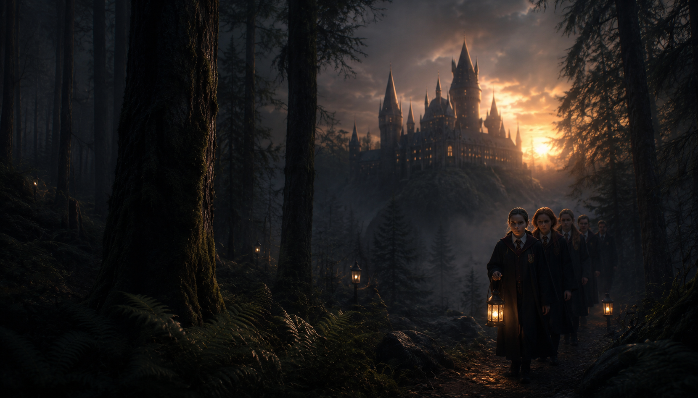

<div align="center">

# SITE HARRY POTTER — Uma apresentação digital de Hogwarts

Projeto de estudo desenvolvido em **Astro e React** para apresentar a Escola de Magia e Bruxaria de Hogwarts por meio de uma experiência editorial, responsiva e interativa.

[](https://astro.build/)
[](https://react.dev/)


### [Acessar demonstração na Vercel →](https://site-harry-potter-omega.vercel.app)

</div>



## Visão geral

O **Site Harry Potter** transforma Hogwarts em uma apresentação escolar completa, escrita em português e organizada como uma experiência digital imersiva. A página reúne informações sobre ensino, acolhimento, Casas, atividades, notícias e processo de admissão, combinando imagens temáticas, tipografia inspirada no universo mágico e interações orientadas por rolagem.

O projeto foi construído como exercício de desenvolvimento front-end. Durante sua evolução, trabalhei principalmente a adaptação visual de uma referência, a personalização do conteúdo, o uso de componentes React dentro do Astro e a validação de animações mais complexas no navegador.

> **Aviso:** este é um projeto educacional e não oficial, sem vínculo com a Warner Bros., a franquia Harry Potter ou seus detentores de direitos. Nomes e referências do universo são utilizados apenas para fins de estudo e demonstração técnica.

## Uso de inteligência artificial

Este projeto foi desenvolvido **quase integralmente com assistência de IA generativa**, principalmente por meio do OpenAI Codex. A IA apoiou a adaptação do layout, a escrita e revisão dos textos, a criação e integração dos componentes, a depuração, os testes visuais, o versionamento e a documentação.

Não apresento este repositório como código escrito integralmente à mão. Ele registra um processo de aprendizado assistido, no qual pratiquei como definir requisitos, comparar resultados, encontrar inconsistências, solicitar correções e acompanhar uma aplicação até sua publicação.

## Meu papel no processo

Minha participação concentrou-se em:

- Definir Hogwarts como tema e direcionar a identidade visual do projeto;
- Selecionar referências, imagens, cores, fontes e composição das seções;
- Solicitar a tradução e adaptação de todo o conteúdo para português;
- Avaliar cada versão diretamente no navegador;
- Identificar problemas de corte, proporção, tipografia, rolagem e sincronização;
- Orientar os ajustes do rastro mágico, dos cards empilhados e do slider de imagens;
- Validar o comportamento do cabeçalho, rodapé e elementos responsivos;
- Acompanhar os builds do Astro e os testes visuais automatizados;
- Organizar o projeto para GitHub e publicação na Vercel.

Como estudante, meu objetivo é compreender e conseguir explicar as principais partes da solução, mesmo quando a implementação inicial foi sugerida pela IA.

## Projeto em números

| Entrega | Resultado |
| --- | --- |
| Página principal | 1 |
| Componentes Astro e React | 11 |
| Imagens temáticas integradas | 22 |
| Sliders interativos | 2 experiências |
| Efeitos de ponteiro | 1 rastro mágico em canvas |
| Ambientes | Desenvolvimento e produção |

## Experiência da página

- Cabeçalho fixo que permanece visível durante toda a rolagem;
- Hero cinematográfico com Hogwarts, personagem e chamada principal;
- Identidade visual em roxo profundo, branco e tons escuros;
- Brasão adaptado para fundos claros, escuros e coloridos;
- Conteúdo integralmente revisado em português;
- Rastro mágico em canvas que acompanha o movimento do ponteiro;
- Seção de bem-estar e currículo com transição WebGL entre imagens;
- Texto sincronizado com o ponto central da transição visual;
- Cards de novidades empilhados durante a rolagem;
- Galerias, cartões editoriais e seções de descoberta;
- Rodapé temático com apresentação das Casas de Hogwarts;
- Ajustes responsivos para telas grandes, tablets e celulares;
- Alternativas de movimento para usuários com `prefers-reduced-motion`.

## Tecnologias e ferramentas

| Tecnologia | Aplicação no projeto |
| --- | --- |
| **Astro 7** | Estrutura da página, assets e geração do site estático |
| **React 19** | Componentes interativos carregados como ilhas |
| **HTML5** | Estrutura semântica, imagens, navegação e conteúdo |
| **CSS3** | Grid, responsividade, tipografia, cores e animações |
| **JavaScript** | Comportamentos de rolagem, ponteiro e controles |
| **GSAP** | Sincronização das transições do slider |
| **OGL / WebGL** | Morph slider com distorção entre imagens |
| **Lenis** | Suavização da experiência de rolagem |
| **Canvas API** | Rastro mágico que acompanha o cursor |
| **Git e GitHub** | Versionamento e publicação do código-fonte |
| **Vercel** | Build, hospedagem e deploy contínuo |
| **OpenAI Codex** | Apoio na implementação, revisão, testes e documentação |

## Organização do código

```text
src/
├── assets/
│   └── fotos/
│       └── website-images/
├── components/
│   ├── CanvasCursor.jsx
│   ├── HogwartsMorphSection.jsx
│   ├── HogwartsNewsStack.jsx
│   ├── MorphSlider.jsx
│   └── ScrollStack.jsx
├── hooks/
│   └── useCanvasCursor.js
├── layouts/
│   └── Layout.astro
├── pages/
│   └── index.astro
└── styles/
    └── fonts.css
```

O `index.astro` reúne a estrutura editorial da página. Os efeitos mais complexos foram isolados em componentes React, enquanto o hook do cursor concentra a animação do rastro mágico. Os estilos específicos permanecem próximos de cada componente para facilitar manutenção e testes.

## Desafios e soluções

| Desafio | Solução aplicada |
| --- | --- |
| Manter o cabeçalho visível ao subir e descer a página | Remoção do comportamento de ocultação e uso de posicionamento fixo consistente |
| Preservar a leitura do brasão em fundos diferentes | Variações visuais e filtros adequados ao contexto de cada seção |
| Criar um rastro mágico natural e responsivo | Canvas em tela cheia, pontos interpolados e ajuste de comprimento, velocidade e espessura |
| Empilhar notícias sem interromper o fim da página | Cálculo da área de rolagem e liberação correta do fluxo após o último card |
| Fazer as imagens aparecerem no morph slider | Carregamento explícito das texturas e imagem HTML de segurança |
| Sincronizar texto e imagem no slider | Mudança do conteúdo vinculada diretamente a 50% do progresso WebGL |
| Evitar cortes indesejados nos cards | Ajustes de proporção e `object-position` conforme o enquadramento |
| Manter a experiência acessível | Foco visível, textos alternativos e suporte a redução de movimento |

## Executar localmente

Requisitos:

- Node.js 22.12 ou superior;
- npm.

```bash
npm install
npm run dev
```

O servidor de desenvolvimento será iniciado em `http://localhost:4321`.

Para validar a versão de produção:

```bash
npm run build
npm run preview
```

## Prática com Git e GitHub

Este repositório também faz parte do meu estudo de versionamento e publicação. O fluxo aplicado inclui:

- Preparação dos arquivos que realmente pertencem ao projeto;
- Criação da branch principal `main`;
- Escrita de mensagens de commit relacionadas à entrega;
- Publicação do código no GitHub;
- Integração do repositório com a Vercel;
- Validação do build antes do deploy;
- Consulta do histórico para acompanhar a evolução do projeto.

[Consultar o histórico de commits →](https://github.com/tiagolaitharth/site-harry-potter/commits/main/)

## Competências praticadas

- Desenvolvimento front-end;
- Construção de interfaces responsivas;
- Componentização com Astro e React;
- Integração de WebGL e Canvas;
- Animações sincronizadas com interação e rolagem;
- Organização e manutenção de CSS;
- Depuração visual no navegador;
- Testes de build e comportamento;
- Versionamento com Git e GitHub;
- Deploy e integração contínua com a Vercel;
- Definição de requisitos e condução iterativa com IA;
- Avaliação crítica de resultados produzidos por IA.

## Status e limitações

A página principal e suas interações estão funcionais. O projeto representa uma apresentação conceitual: links como inscrição, currículo e envio de mensagem não estão conectados a sistemas reais, e os conteúdos institucionais são fictícios.

Alguns recursos visuais dependem de WebGL. Quando esse recurso não está disponível, o slider mantém uma imagem estática de segurança para evitar áreas vazias.

## Próximas melhorias

- Criar páginas internas para currículo, Casas e processo de admissão;
- Substituir links demonstrativos por rotas reais do projeto;
- Executar auditorias com Lighthouse;
- Adicionar testes automatizados de interface e acessibilidade;
- Otimizar os arquivos de imagem para conexões móveis;
- Revisar dependências herdadas da referência visual;
- Criar uma galeria com detalhes das quatro Casas.

## Sobre mim

Sou estudante do curso de **Análise e Desenvolvimento de Sistemas**, em início de carreira. Uso projetos práticos e ferramentas de IA para transformar o conteúdo estudado em experiências funcionais e fortalecer meus conhecimentos em desenvolvimento web.

Este projeto demonstra minha capacidade de conduzir uma ideia até uma versão publicada, aprender por meio de iterações e utilizar IA com transparência.
